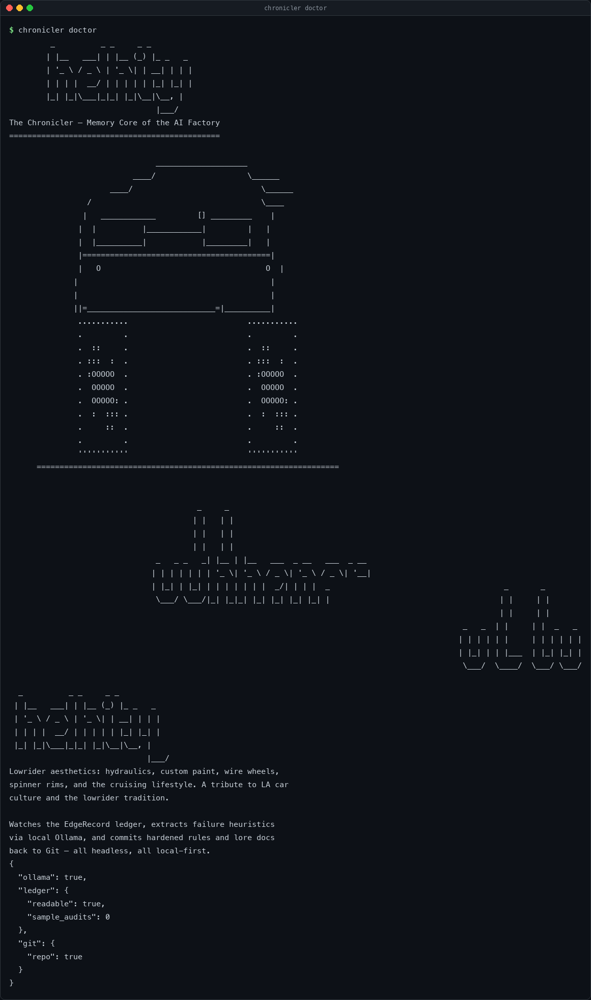
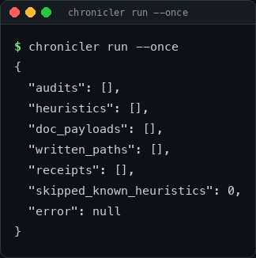

# The Chronicler

[](https://github.com/hamanakam1/the-chronicler/actions/workflows/ci.yml)
[](LICENSE)
[](https://www.python.org/downloads/release/python-3120/)
[](https://github.com/hamanakam1/the-chronicler/actions/workflows/ci.yml)
[](https://github.com/hamanakam1/the-chronicler/blob/main/Dockerfile)
[](https://github.com/hamanakam1/the-chronicler/releases)

**The memory core of the autonomous AI software factory.**

<div align="center">

```text
         _          _ _     _ _         
        | |__   ___| | |__ (_) |_ _   _ 
        | '_ \ / _ \ | '_ \| | __| | | |
        | | | |  __/ | | | | | |_| |_| |
        |_| |_|\___|_|_| |_|\__|\__, |
                                |___/ 
```

```text
                                ____________________
                           ____/                    \______
                      ____/                            \______
                 /                                     \____
                |   ____________         [] _________    |
               |  |          |____________|         |   |
               |  |__________|            |_________|   |
               |=========================================|
               |   O                                    O  |
              |                                          |
              |                                          |
              ||=____________________________=|__________|
               ...........                          ...........
               .         .                          .         .
               .  ::     .                          .  ::     .
               . :::  :  .                          . :::  :  .
               . :OOOOO  .                          . :OOOOO  .
               .  OOOOO  .                          .  OOOOO  .
               .  OOOOO: .                          .  OOOOO: .
               .  :  ::: .                          .  :  ::: .
               .     ::  .                          .     ::  .
               .         .                          .         .
               '''''''''''                          '''''''''''
      ==================================================================


                                         _     _
                                        | |   | |
                                        | |   | |
                                        | |   | |
                                _   _ _   _| |__ | |__   ___  _ __   ___  _ __
                               | | | | | | | '_ \| '_ \ / _ \| '_ \ / _ \| '__|
                               | |_| | |_| | | | | | | |  _/| | | |  _                                      _       _
                                \___/ \___/|_| |_|_| |_| |_| |_| |_| |                                     | |     | |
                                                                                                           | |     | |
                                                                                                   _   _  | |     | |  _   _
                                                                                                  | | | | | |     | | | | | |
                                                                                                  | |_| | | |___  | |_| |_| |
                                                                                                   \___/  \____/  \___/ \___/
```

</div>

<sub><i>The memory core of the autonomous AI software factory.</i></sub>

---

## Core Autonomous Superpowers

1. **Asynchronous Ingest** — continuously polls the EdgeRecord ledger for friction points: failed execution logs, nasty stack traces, and the exact correction prompts that eventually fixed the bug.
2. **Pattern Extraction** — routes the raw friction through the local LLM (Ollama + Qwen) asking: *"What did the bots mess up, and what's the permanent fix?"*
3. **Dynamic Rule Hardening** — drafts new architectural rules / prompt context injections (e.g. updates to `RULES.json`, `SKILLS.md`) so the next pipeline run is inherently smarter.
4. **Lore Synthesis (Auto-Docs)** — translates raw semantic git diffs into human-readable markdown documentation, API maps, and system state records.

The Chronicler is the background daemon that cures *comprehension debt* — the gap where the execution agent (Taskrivet) burns retries figuring out a local network config, then forgets it tomorrow. It is the pipeline's amnesia-buster: an autonomous lore-keeper, meta-learning brain, and documentation engine that watches the append-only **EdgeRecord** ledger, extracts the golden fix from failure logs, hardens the target repository's rules, and commits the upgraded rules plus synthesized lore docs back to local Git — all headless, all local-first, all via local Ollama.

## The Mission

> If the bot burned through three retry loops figuring out a local network config, it will make the exact same mistake tomorrow. The Chronicler is the amnesia-buster.

## Execution Environment

- **Local-first, containerized background daemon** (Docker), running stealthily in the background during idle compute cycles.
- **AI Integration:** no proprietary cloud LLMs. All log analysis and pattern extraction route through local Ollama/OpenClaw endpoints using models like Qwen.
- **State & Logging:** reads the "battle scars" from the append-only ledger (EdgeRecord), commits the "lessons learned" back to local Git.
- **Interface:** strictly CLI-driven and headless. No GUI. It watches, thinks, and writes in the shadows.

## Quick Start

```bash
# 1. Clone the memory core
git clone <target-repo> the-chronicler && cd the-chronicler

# 2. Point it at your local ledger + target repo (env overrides below)
export CHRONICLER_LEDGER_PATH=~/.taskrivet/ledger.sqlite
export CHRONICLER_REPO_ROOT=~/Projects/taskrivet

# 3. Sanity-check the black ops setup
chronicler doctor

# 4. Ingest one batch and commit what it learns
chronicler run --once

# 5. Watch the shadows
chronicler watch
```

### Container image

A published image is built and smoke-tested on every release tag.

```bash
docker pull ghcr.io/hamanakam1/the-chronicler:0.1.0
docker run --rm ghcr.io/hamanakam1/the-chronicler:0.1.0 doctor
```

The image runs as a non-root user. See the
[package on GitHub](https://github.com/hamanakam1/the-chronicler/pkgs/container/the-chronicler).

### Docker Compose

`docker-compose.yml` brings up Ollama and the Chronicler together, wired to
each other over the compose network:

```bash
docker compose up -d          # start ollama + chronicler
docker compose logs chronicler
docker compose down
```

It mounts the checkout at `/chronicler`, keeps the daemon state in the
`chronicler-data` volume, and points the LLM at the `ollama` service.

## What it looks like

Both screenshots below are real output, captured by
[`scripts/make_screenshots.py`](scripts/make_screenshots.py) — the script drives
the CLI and paints the bytes it wrote. Nothing is hand-drawn.

`chronicler doctor` reports whether the black-ops setup is actually wired up:



`chronicler run --once` runs a single orchestration cycle and reports what it
read, what it learned and what it committed:



## Configuration

| Env var | Default | Purpose |
| --- | --- | --- |
| `CHRONICLER_OLLAMA_BASE_URL` | `http://localhost:11434` | Local Ollama endpoint |
| `CHRONICLER_OLLAMA_MODEL` | `qwen3.8:latest` | Local reasoning model |
| `CHRONICLER_OLLAMA_TIMEOUT_SECONDS` | `120` | Per-request timeout against the local LLM |
| `CHRONICLER_LEDGER_PATH` | `~/.taskrivet/ledger.sqlite` | Append-only EdgeRecord ledger |
| `CHRONICLER_REPO_ROOT` | target checkout | Repo receiving hardened rules + docs |
| `CHRONICLER_RULES_FILE` | `RULES.json` | Hardened ruleset output target |
| `CHRONICLER_SKILLS_FILE` | `SKILLS.md` | Prompt-context injection output target |
| `CHRONICLER_LORE_DIR` | `docs/lore` | Generated lore docs location |
| `CHRONICLER_HEURISTIC_STORE_DIR` | `.chronicler/heuristics` | Local heuristic cache directory |
| `CHRONICLER_STATE_PATH` | `~/.chronicler/state.json` | Daemon watermark / dedupe state |
| `CHRONICLER_POLL_INTERVAL_SECONDS` | `30` | Watcher cadence |
| `CHRONICLER_AUDIT_BATCH_LIMIT` | `25` | Max audits per cycle |
| `CHRONICLER_GIT_REMOTE` | `origin` | Git remote for zero-intervention push |
| `CHRONICLER_GIT_PUSH` | `true` | Enable automatic push |

Every variable can also live in a `.env` file next to the checkout.

## CLI

| Command | What it does |
| --- | --- |
| `chronicler doctor` | Health check the local setup: Ollama reachable, ledger readable, target repo is a Git repo. Exits non-zero if anything is broken. |
| `chronicler run --once` | Run a single ingest → extract → harden → document → commit cycle and print the report as JSON. |
| `chronicler watch` | Run the headless daemon loop, polling on `CHRONICLER_POLL_INTERVAL_SECONDS`. |

Global flags work before *or* after the subcommand:

| Flag | Default | What it does |
| --- | --- | --- |
| `-q`, `--quiet` | off | Suppress the ASCII banner. |
| `--log-level` | `info` | Daemon log verbosity: `debug`, `info`, `warning`, `error`, `critical`. |

The ASCII banner is written to **stderr**, so stdout stays machine readable:

```bash
chronicler doctor | jq .ollama          # works: stdout is pure JSON
chronicler doctor --quiet               # no banner at all
chronicler --quiet doctor               # same thing, flag before the subcommand
chronicler watch --log-level debug      # verbose daemon log
```

## Architecture

```
┌─────────────────┐     ┌──────────────────┐     ┌──────────────────┐
│ EdgeRecord      │────▶│ Meta-Learning    │────▶│ Local Git / FS   │
│ Watcher         │     │ Brain            │     │ Ninja            │
│ (polling)       │     │ (Ollama + Qwen)  │     │ (commit+push)    │
└─────────────────┘     └──────────────────┘     └──────────────────┘
        ▲                        │                          │
        └──────── Lore Docs ◀────┘                          │
                          ┌──────────────┘
                          ▼
                   Target Repo
                   (RULES.json, SKILLS.md, docs/lore/)
```

Module map:

| Module | Responsibility |
| --- | --- |
| `chronicler.schemas` | Pydantic data contracts: `ExecutionAuditLog`, `ExtractedHeuristic`, `DocUpdatePayload` |
| `chronicler.ledger` | EdgeRecord reader (`SQLiteEdgeRecordReader`) + async `EdgeRecordWatcher` poller |
| `chronicler.llm` | `OllamaClient` + prompt builders (`What did the bots mess up, and what's the permanent fix?`) |
| `chronicler.brain` | `ChroniclerBrain` orchestration loop + `HeuristicExtractor` + `ChroniclerState` |
| `chronicler.rules` | `RuleHardener` — drafts hardened rules / prompt injections |
| `chronicler.docs` | `DocSynthesizer` — turns heuristics into `DocUpdatePayload` |
| `chronicler.gitops` | `LocalGitCommitter` — safe writes + zero-intervention commit/push |
| `chronicler.ascii_art` | The lowrider wordmark rendered by the CLI banner |
| `chronicler.cli` | Headless CLI: `run`, `watch`, `doctor` |

## Deliverables Implemented

1. **Pydantic / JSON Schemas (Data Contracts)**
   - `ExecutionAuditLog` — the raw friction data scooped from EdgeRecord (task, category, fingerprint, summary, resolution, timestamps).
   - `ExtractedHeuristic` — the "Aha!" moment: insight, generalized rule, confidence, status (`draft`/`promoted`).
   - `DocUpdatePayload` — structured map of generated markdown → target file paths.
2. **Architecture & Directory Tree** — modular layout above with strict separation between watcher / brain / rules / docs / git layers.
3. **Meta-Learning Brain (Core Orchestration)** — `ChroniclerBrain.run_cycle` scoops the latest failure batch, asks local Ollama, formats the fix into the target ruleset, commits rules + docs.
4. **Local Git & File-System Ninja Module** — `LocalGitCommitter` safely writes LLM payloads to disk and executes local `git commit` + push with zero human intervention.

## Safety & Hardening Notes

- Path-traversal guard in the committer (`UnsafePathError`) before any write.
- Heuristic IDs are deterministically derived from `(failure_category, fingerprint)` so dedupe across cycles is stable.
- Watermarking via `ChroniclerState` persists the UTC timestamp and numeric failure ID, so bounded batches resume within a shared timestamp without skipping rows, including after restart. Existing timestamp-only state keeps its strictly-newer behavior until the next batch establishes an ID cursor; previously skipped rows are not recovered automatically.
  Cursor precision relies on the append-only ledger retaining the boundary failure
  row. Custom readers without canonical numeric failure IDs retain timestamp-only
  behavior.
- Push is configurable (`CHRONICLER_GIT_PUSH`) and commit receipts are captured per cycle.
  A successful local commit remains reported and checkpointed if its push fails:
  the receipt keeps `status: "committed"` and the local SHA, sets `pushed: false`,
  and records the delivery failure in `push_error` (also logged as a warning).
  Failed pushes are not retried automatically; actual local commit failures still
  fail the audit.
- The ledger reader returns the **oldest** unprocessed failures first, so a backlog drains in order and the watermark never hides an older row behind a newer one.
- A single unusable failure is isolated: the rest of the batch still lands, and the failure is reported in `failed_audits` rather than aborting the cycle.
- Writing identical bytes twice is a no-op (`status: "unchanged"`), not a commit error.
- Commits include only the explicitly requested files, with filenames treated literally.
  Unrelated staged and unstaged changes are preserved; unchanged generated files do
  not trigger a commit of someone else's staged work. Commit paths must name files,
  not directories.
- State checkpoints use a unique temporary file and atomic replacement. An interrupted
  write or failed replacement preserves the previous readable checkpoint.

Generated output paths are checked as a complete plan before any file is written.
They must name distinct regular files in a usable Git worktree, with no symlink
components, Git metadata targets, nested repository/submodule traversal, tracked
directory replacements, or file/parent overlaps. Names that differ only by case or
Unicode normalization are treated as the same output for Mac filesystem compatibility,
including aliases of existing files or directories. Untracked outputs ignored by Git
are rejected before writing; tracked files remain writable even when an ignore rule
matches them. Explicit Git commits may still record a symlink itself or its deletion;
generated content never follows the link.
This preflight preserves existing files when a plan is invalid. It is not a
transaction across files: a later I/O or Git failure can leave earlier valid writes.
The standalone `write_text` helper also supports ordinary directories without Git;
the brain's full output plan requires a usable Git worktree before it writes.

### Current rule-output limitation

Each successfully processed heuristic **replaces** the configured `RULES.json` and
`SKILLS.md` outputs. These files contain the latest heuristic; previous rules and
handwritten content at those paths are not merged or retained. Set
`CHRONICLER_RULES_FILE` and `CHRONICLER_SKILLS_FILE` to dedicated generated files.
Lore documents use a separate path per heuristic. Cumulative rule merging remains
unimplemented.

## Changelog

Release notes live in [CHANGELOG.md](CHANGELOG.md).
